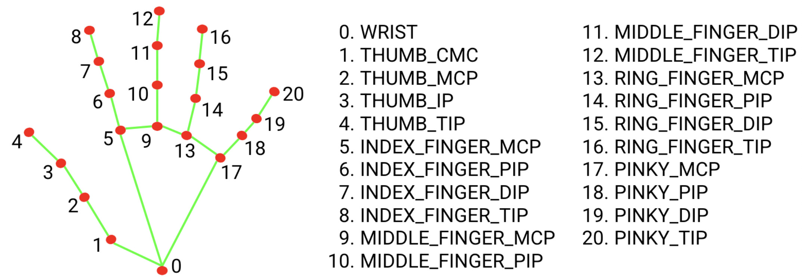

# Part 1: 2D Grid Control via Hand Tracking (MediaPipe)

This is the first iteration of my personal VR controller project. The goal was to build a real-time interaction system without relying on any dedicated VR hardware, using only a standard webcam and an Intel Core i5 CPU.

## 🎯 How it works

This script captures webcam feed, extracts 3D hand landmarks using Google's MediaPipe, and translates specific hand gestures into actionable commands on a virtual 2D grid HUD.

### MediaPipe Hand Landmarks Reference
To understand the logic behind the gesture recognition, here is the landmark topology provided by MediaPipe:


*(Image source: Google MediaPipe Documentation)*

- **Pinch Detection:** The system calculates the 3D Euclidean distance between the thumb tip (landmark 4) and the middle finger tip (landmark 12). If the distance is below a specific threshold (`< 0.06`), a "pinch" is registered.
- **Directional Control:** Once the pinch is held, the relative position of the index finger (landmark 8) compared to the palm controls the displacement of a cursor (`#`) across a 35x36 virtual grid overlay.
- **UDP Streaming:** In preparation for 3D engine integration (Part 2), all 21 hand landmarks (X, Y, Z coordinates) are continuously packed into byte arrays (`struct.pack`) and streamed locally via UDP (Port 5065).

## 🛠️ Requirements

- Python 3.x
- OpenCV (`cv2`)
- MediaPipe (`mediapipe`)
- Numpy (`numpy`)

*Note: Ensure the `hand_landmarker.task` model is placed in the `models/` directory.*

## 🚀 How to run

1. **Install dependencies:**
   ```bash
   pip install -r requirements.txt

2. **Run the script:**
   ```bash
   python main.py

3. **Show your hand to the webcam. Pinch your thumb and middle finger together and move your hand to navigate the cursor on the terminal grid!**

## 📸 Demo

