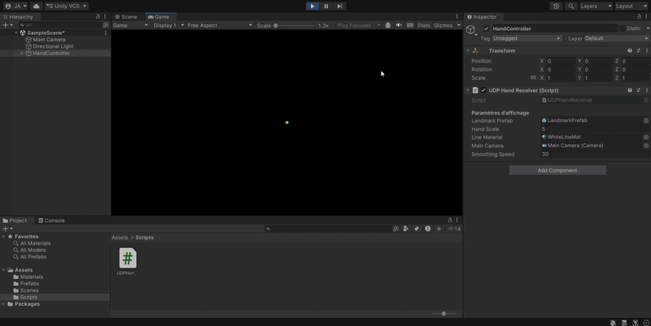

# Part 2: 3D Virtual Hand Controller (Unity)

This module receives the real-time spatial coordinates generated by the Python/MediaPipe tracker (Part 1) via UDP and maps them onto a 3D skeleton in Unity.

## 🎯 How It Works
Instead of relying on heavy plugins, this project uses a custom, lightweight UDP communication pipeline. 
1. **Data Reception:** A background thread listens on port `5065` for the 63 float values (21 landmarks x 3 axes, 252 bytes) sent by the Python script.
2. **Thread-Safe Synchronization:** A locking mechanism ensures that the main Unity thread only updates the rendering when new, complete data packets arrive, preventing memory access conflicts or crashes upon exit.
3. **Coordinate Mapping:** MediaPipe's normalized coordinates are converted to Unity's absolute 3D space, with specific axis inversions to match the spatial referentials.
4. **Smooth Rendering:** Spheres (joints) and LineRenderers (bones) are updated using a customizable `Vector3.Lerp` to mask hardware-induced latency, ensuring smooth visual feedback even on hardware without a dedicated GPU.

## 🛠️ Requirements
- **Unity Editor:** Version `2022.3.x LTS` (Built-in Render Pipeline).
- **Python Environment:** Python 3.x with dependencies installed (see Part 1).

## 🚀 Setup & Execution
1. Open **Unity Hub**.
2. Click on **Add** -> **Add project from disk** and select the `Part2_Unity_Virtual_Hand` folder.
3. Once the project opens, navigate to your `Assets/` folder in the Project window and double-click the main scene (or drag the `HandController` prefab into a new scene).
4. Ensure the Python tracker (Part 1) is running and actively broadcasting UDP packets on port `5065`.
5. Press **Play** in the Unity Editor. 
6. Bring your hand into the webcam's view. The 3D hand skeleton will instantly appear and track your movements.

## ⚙️ Configuration
Select the `HandController` object in the Unity Hierarchy to adjust the `UDPHandReceiver` script parameters in real-time:
- **Hand Scale:** Adjusts the overall spread of the virtual hand.
- **Smoothing Speed:** Controls the interpolation speed. Higher values reduce latency but may reveal webcam tracking jitters; lower values increase visual smoothness.