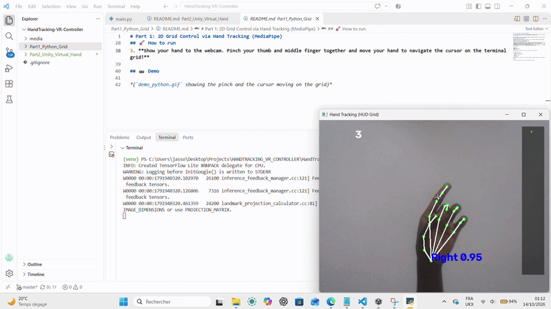

# 🖐️ HandTracking VR Controller: From Python to Unity

Welcome to my personal exploration project focused on Human-Computer Interaction (HCI) and real-time hand tracking. 

The primary objective of this project was to build a seamless, real-time virtual interaction system (hand tracking and virtual object control) utilizing highly constrained hardware resources (an Intel Core i5 processor without a dedicated GPU). 

By bridging Python's computer vision capabilities with Unity's 3D rendering through a custom network architecture, this repository demonstrates a lightweight, hardware-agnostic approach to VR controllers.

## 🚀 Project Architecture & Progression

The project is structured into two evolutionary modules:

### [Part 1: 2D Grid Control (Python & MediaPipe)](./Part1_Python_Grid/)
The foundational module. It captures the webcam feed, processes the 3D hand topology using Google's MediaPipe, and translates specific gestures into screen commands.
- **Technical Logic:** The system detects a "pinch" action by calculating the 3D Euclidean distance between the thumb tip (landmark 4) and the middle finger tip (landmark 12).
- **HUD Interaction:** Once pinched, the index finger controls a cursor on a virtual 2D grid overlay.



### [Part 2: 3D Virtual Hand (Unity & UDP Streaming)](./Part2_Unity_Virtual_Hand/)
The spatial module. Instead of relying on heavy integration plugins, it uses a custom UDP client/server architecture to stream coordinates in real-time.
- **Network Pipeline:** Python broadcasts the 21 landmarks (X, Y, Z coordinates) as packed binary arrays over a local UDP socket (Port 5065).
- **Unity Rendering:** A thread-safe C# script receives the packets, maps the normalized coordinates to absolute 3D space, and applies a `Vector3.Lerp` smoothing algorithm to mask hardware latency and ensure fluid rendering.


## 🧠 Why This Architecture?
In professional tracking systems (like OptiTrack or Vicon), spatial data is frequently streamed over local networks to 3D engines. By replicating this UDP streaming architecture, I ensured that the heavy lifting (computer vision) and the visual feedback (Unity) are completely decoupled. This guarantees maximum performance, thread safety, and stability on low-end hardware setups.

## 📂 Repository Structure
```text
HandTracking-VR-Controller/
├── Part1_Python_Grid/          # Python tracking script & logic
├── Part2_Unity_Virtual_Hand/   # Unity 3D visualization project
└── media/                      # Architecture references and demo GIFs